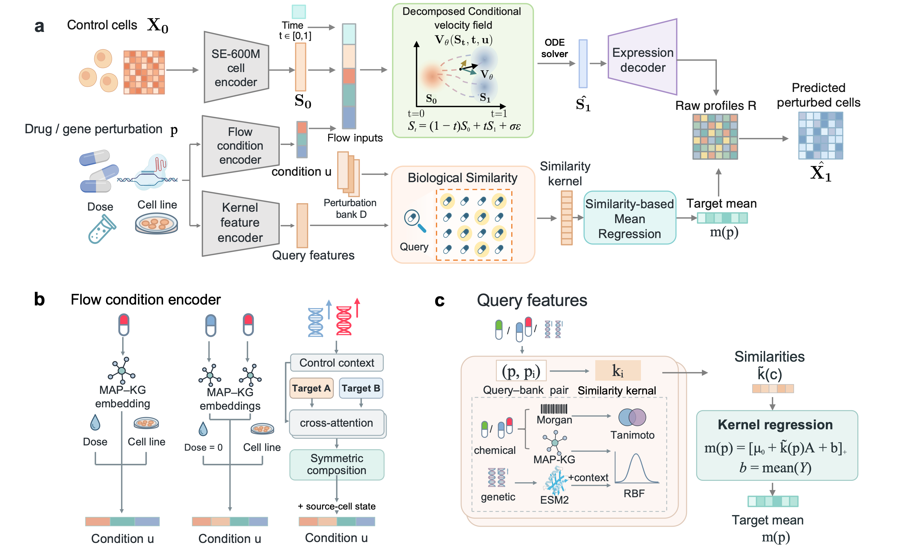

# DeVFlow

a knowledge-enhanced decomposed flow-matching framework that combines cell-level variation modeling with explicit expression-mean calibration.


## Overview



## Installation

From the repository root, with Python 3.9 and a CUDA-enabled PyTorch installation:

```bash
python -m pip install -r requirements.txt
```

## Data and pretrained weights

Set the locations of your prepared data, feature assets and pretrained weights:

```bash
export DEVFLOW_DATA_ROOT=/path/to/prepared_data
export DEVFLOW_ASSET_ROOT=/path/to/prepared_assets
export DEVFLOW_WEIGHT_ROOT=/path/to/pretrained_weights
```
Pretrained assets: https://drive.google.com/drive/folders/1UY2cqFqpyj71lEBfeIMzz_AWypCi5RsB?usp=drive_link

## Preprocessing

Training uses prepared expression data and cached SE embeddings. The migrated
preprocessing sources include dataset preparation and SE/cache extraction:

```bash
python -m preprocessing --help
python -m preprocessing sciplex3 --help
python -m preprocessing combosciplex --help
python -m preprocessing norman --help
python -m preprocessing verify
```

Dependencies are included in the shared `requirements.txt`. Raw data, pretrained
SE weights and gene/drug feature assets are explicit inputs to those commands.

## Usage

Choose a configuration and fill in the required input paths:

 | Configuration |
 | --- |
| [Sciplex3 for unprofiled drug perturbation prediction](configs/sciplex3_mlp_mean_mmd_50k.json) |
| [ComboSciPlex for combinarial drug perturbation prediction ](configs/combosciplex_mlp_mean_mmd_13k.json) |
| [Norman for genetic combination perturbation prediction](configs/norman_additive.json) |

Set `data.target_se_assets` to the prepared training-control target gene tokens. 
For prediction or evaluation, set `prediction.checkpoint` in the configuration
to the saved model:

```bash
python -m devflow.cli sciplex3 --config YOUR_CONFIG.json predict
python -m devflow.cli sciplex3 --config YOUR_CONFIG.json evaluate
```

Use `python -m devflow.cli TASK --help` for each dataset's available commands,
where `TASK` is `sciplex3`, `combosciplex` or `norman`.
Checkpoints, metrics and predictions are saved under `outputs/`.
Mean/MMD training also generates live monitor notebooks and HTML in its run directory.
